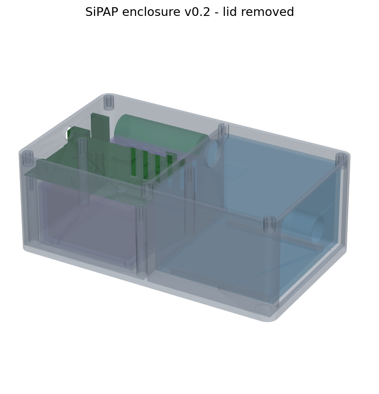
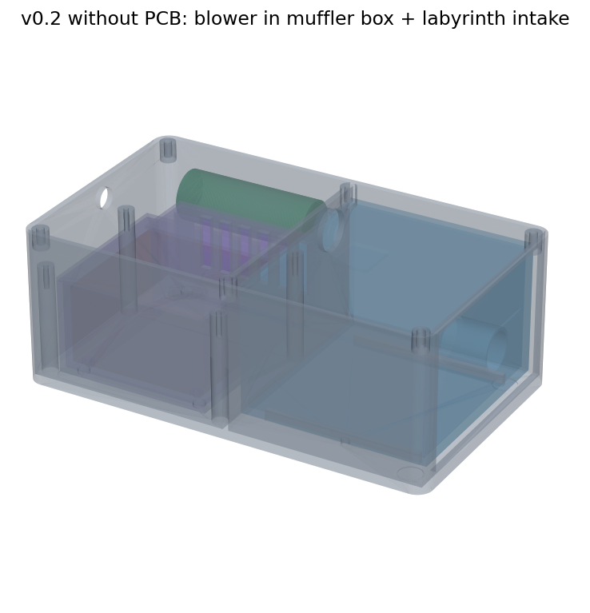

# SiPAP — vỏ hộp v0.2 (FreeCAD, tham số hoá): gọn, êm, chống nhiễu

Dựng lại: `"D:\Program Files\FreeCAD 1.1\bin\freecadcmd.exe" sipap_enclosure.py` (đường dẫn có dấu tiếng Việt thì đặt biến `SIPAP_OUT` ra thư mục không dấu), rồi `python render_preview.py out`.
Mọi kích thước là tham số đầu file — đổi blower / dung tích bình chỉ cần sửa số và chạy lại.

## So với v0.1
| | v0.1 | v0.2 |
|---|---|---|
| Kích thước ngoài | 309 × 125 × 82 mm | **213 × 124 × 82 mm** (−31 %) |
| Số khoang | 3 (điện tử / blower / làm ẩm) | 2 — **blower nằm dưới PCB** trong hộp tiêu âm |
| Chống ồn | vách ngăn + chân cao su | hộp tiêu âm kín + mút + **mê cung hút gió 2 vách** + lọc + bình nước làm buồng tiêu âm đầu ra |
| Vách | 2.5 mm | **3 mm** (cứng hơn, ít cộng hưởng) |

## Chống ồn / chống rung
1. **Blower trong hộp tiêu âm kín** (chi tiết in riêng `sipap_muffler`): blower đặt trên **4 trụ cao su (grommet)**, cách vách 2–3 mm để lót **mút tiêu âm** (mút PU kín khí, dày 2–3 mm).
2. **Mê cung hút gió**: khí vào qua lưới vách sau → **tấm lọc** → 2 vách so le (khe trên/khe dưới) → buồng blower. Tiếng ồn quạt phải đổi hướng 2 lần mới ra ngoài.
3. **Hộp tiêu âm đặt trên 4 chân cao su** tách khỏi đáy vỏ; vỏ có 4 hốc dán chân cao su xuống bàn.
4. Đầu ra blower đi **ống silicon mềm** (không nối cứng) → SFM3300 → bình nước; **bình nước (~300 mL không khí phía trên mặt nước) làm buồng giãn nở tiêu âm** trước khi khí ra mặt nạ.

## Chống nhiễu điện (EMI)
1. Blower và driver của nó nằm trong hộp riêng, **dưới** board, xa 2 cảm biến áp U2/U3 (mép phải board).
2. Cáp blower vào J2 **xoắn đôi** (12V với GND, PWM với FG), ngắn < 10 cm vì blower ngay dưới J2; thêm **ferrite kẹp** trên cáp nếu đo thấy nhiễu.
3. Có thể sơn/dán **băng đồng bên trong hộp tiêu âm** nối GND (lồng Faraday cho motor). **Không** đặt kim loại phía trên mép sau board quanh anten ESP32 (U1).
4. Cáp SFM3300 ≤ 10 cm (theo datasheet, dài hơn phải dùng cáp bọc chống nhiễu).

## Gọn gàng / dễ tháo
- Nắp 6 vít M3 vào **insert nhiệt**; mở nắp thấy toàn bộ board + cổng nạp J3. Board trên 4 trụ cao, tháo 4 vít là nhấc ra, bên dưới là hộp tiêu âm (nhấc ra luôn).
- Dây: blower cắm thẳng lên J2 phía trên; SFM nằm sau board, cáp ngắn tới U4.
- Nước: board và blower nằm **cao hơn/khác khoang** với bình nước; vách giữa kín, khí vào bình từ phía trên mực nước (có gờ chắn bắn); khoang bình có lỗ thoát nước.

## Làm ẩm
Rev C: **làm ẩm thường (pass-over)**, bình tháo rời trượt sang phải, **~310 mL** tại vạch MAX 35 mm, ống thở cắm vào côn 22 mm trên bình. **Chừa 6 mm dưới đáy bình** cho đĩa sưởi ở Rev D (cần nguồn 24 V).

## Kiểm tra tự động (`out/report.json`)
- 6 chi tiết in (đáy, nắp, hộp tiêu âm + nắp, bình + nắp) đều là khối đặc hợp lệ.
- **16/16 cặp va chạm = 0 mm³** (PCB thật từ STEP Altium, blower, SFM3300, bình, hộp tiêu âm, vỏ, nắp).
- Trục encoder nhô **5.5 mm** khỏi nắp; mặt trên hộp tiêu âm cách đáy board **4.4 mm** → **cắt chân linh kiện xuyên lỗ ≤ 2 mm** sau khi hàn.

## Còn mở
1. **Blower thật** — khối blower là giả định (WM7040: 70 × 40 mm). WM7040-12V ghi **4.8 A / 57.6 W, 45 dB(A)**: vượt F1 4 A và adapter 3.5 A → cần blower ≤ 3 A @12 V hoặc nguồn 24 V ở Rev D.
2. **Bump trên nắp** che cầu chì F1 cao 24.8 mm — bỏ được nếu Rev D dùng PTC dán.
3. STEP Altium ghi board dày 0.39 mm (thiết lập layer stack) — Gerber không ảnh hưởng; model đã căn theo mặt trên board.
4. v0.3 khi có blower: kích thước thật, gioăng bình, khắc chữ/biểu tượng, chia nhỏ chi tiết cho máy in 3D.
