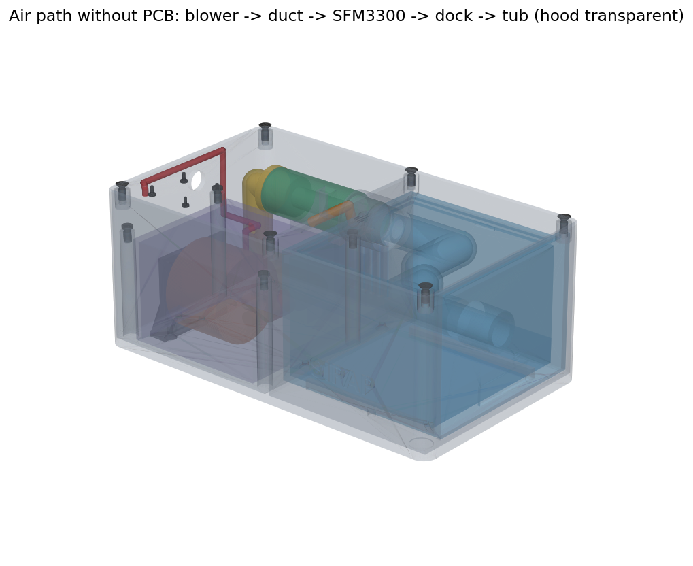
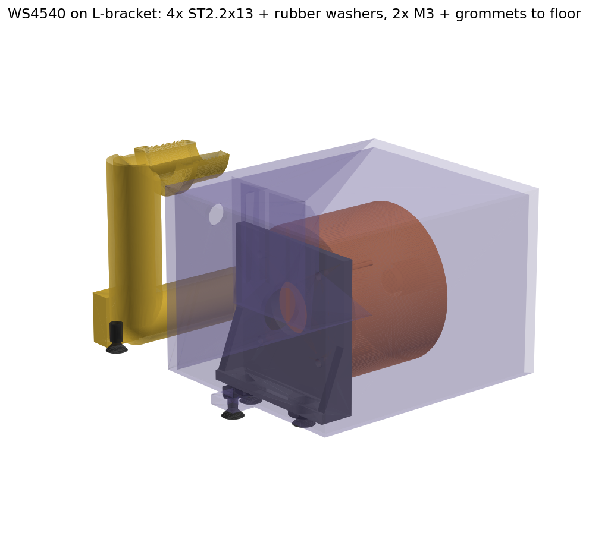
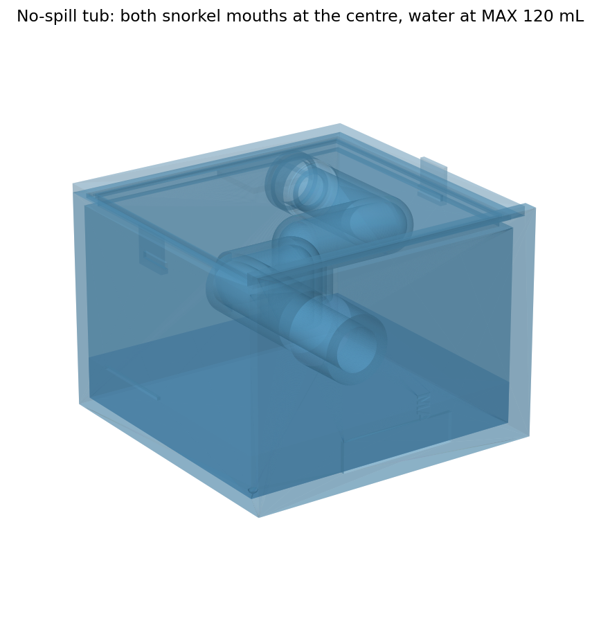

# SiPAP — vỏ hộp v0.3 (FreeCAD, tham số hoá): blower thật, đủ vít, đủ dây/ống

Dựng lại (đường dẫn có dấu tiếng Việt thì đặt `SIPAP_OUT` ra thư mục không dấu):
```
"D:\Program Files\FreeCAD 1.1\bin\freecadcmd.exe" sipap_enclosure.py
python render_preview.py out
python tub_tilt_check.py out/tilt_input.json      # kiểm chống đổ riêng
```
Trong `out/`: 7 chi tiết in dạng `.step` (slicer mở được STEP), `sipap_assembly.step` (vỏ + PCB + blower + vít + cáp + ống), `report.json` (mọi số bên dưới), ảnh. File `.stl` sinh ra khi chạy nhưng không đưa lên git (134 MB).






## Kích thước — vì sao cao hơn v0.2
**212.6 × 124.0 × 89.6 mm** (tính cả côn 22 mm ra mặt nạ: rộng 230.6 mm). v0.2 cao 82 mm nhưng sai ở 2 chỗ, kiểm lại mới thấy:
1. **Blower thật dày 45 mm, volute Ø48** (bản vẽ Wonsmart). Chồng theo chiều cao: mút 2 + hở 1.5 + volute Ø48 + hở 1.5 + mút 2 + vách 2 → nóc hộp tiêu âm z = 60.0 mm. Chân linh kiện xuyên lỗ cắt ≤ 2 mm → đáy PCB z = 63.0 mm.
2. **Đầu cắm Dupont trên header đứng** cao 2.54 + 14 mm, cộng đoạn uốn dây → cần ~21 mm trên board; v0.2 chỉ có 18 mm. v0.3 để 22 mm (đỉnh đầu cắm cách nắp 5.5 mm cho dây đi).

→ **Encoder đổi sang PEC11R-4225F-S0024** (trục dẹt 25 mm, có trong bảng đặt hàng PEC11R; cùng footprint): trục nhô 6.5 mm khỏi nắp. Bản 20 mm chỉ nhô 1.5 mm, không gắn được núm. Đã sửa BOM/CPL.
Vẫn gọn hơn ResMed AirSense 11 (259 × 138 × 94.5 mm).

## Blower Wonsmart WS4540-12-NZ03 — lắp thế nào
Bản vẽ: `Cpap/tools/datasheets/Wonsmart_WS4540-12-NZ03.pdf`.
- Trục blower nằm ngang. **Mặt motor bắt vào ga chữ L** in riêng (`sipap_bracket`): 4 vít **ST2.2 × 13** qua lỗ Ø2.6 của ga + **long đen cao su 1.5 mm**, ăn vào 4 lỗ Ø1.6 sâu 15 mm trên vòng Ø36.8 (hình vuông 26 × 26). Ren ăn 8.5 mm < 15 mm.
- Chân ga tựa trên **2 grommet cao su**, bắt **M3 × 12 đầu bằng từ dưới đáy vỏ** + đai ốc. Như vậy có 2 lớp cách rung (long đen + grommet), blower không chạm sàn/vách (hở 1.5 mm, mút 2 mm).
- Ống hút Ø10 quay vào buồng, cách mút 16.0 mm.
- Ống ra Ø10/Ø8 (tiếp tuyến, phía dưới) → **ống silicone dài 16 mm** → cổng ống dẫn xuyên vách hộp qua grommet. Hai đầu cứng hở nhau 4.0 mm để cắt rung.

## Đường khí
blower → ống silicone → **ống dẫn in (`sipap_duct`)** → đứng lên sau PCB → **côn đực 22 mm** cắm vào đầu cái 22 mm (đầu vào) của SFM3300 → SFM nằm ngang trên 2 giá + dây rút → đầu đực 22 mm cắm vào **dock** (đúc liền vách giữa) → vòi bình (O-ring) → bình → côn 22 mm ra ống thở.
- Ống dẫn: ID 12 mm, bằng kênh SFM3300 11.25 mm (DS mục 4.2); dài 145 mm, 4 khúc cua.
- SFM nằm ngang vì DS mục 4.1 hiệu chuẩn ở tư thế nằm ngang.
- Tổn áp ống dẫn ước tính (Darcy + 0.5 mỗi khúc cua): **1.63 cmH₂O ở 60 L/ph** (v = 8.8 m/s). Blower còn 3.5 kPa ở 82 L/ph nên đủ dư; cần đo thật.
- **Điểm đo áp U2/U3 dời vào dock:** khe 1.7 mm giữa đầu SFM và vòi bình, lỗ Ø1.4, núm Ø3.4 cho ống 3 mm. Đo trước bình, nên tháo bình không phải rút ống áp. Tổn áp qua bình phải đo một lần trên bàn; nếu > 0.2 cmH₂O thì bù trong firmware.

## Chống ồn / rung
1. Blower cách vỏ bằng 2 lớp cao su, nằm trong **hộp tiêu âm** đáy hở (`sipap_hood`) lót **mút PU 2 mm**, mép dưới có gioăng mút.
2. **Mê cung hút gió**: lưới sau → tấm lọc 28 × 42 × 5 → vách 2 (hở dưới) → vách 1 (hở trên) → lỗ vào buồng blower.
3. Bình nước làm buồng giãn nở trước khi khí ra mặt nạ; 4 chân cao su dưới vỏ.

## Bình làm ẩm chống đổ (`sipap_tub` + `sipap_tub_lid`)
**Thiết kế:** ống vào và ống ra đều đi bên trong bình (snorkel), mở miệng úp xuống ngay giữa bình (mỗi miệng cách tâm 7 mm, Ø15). Nước phải dâng tới giữa bình mới vào được miệng ống.

**Kiểm số (`tub_tilt_check.py`):**
- Chia bình thành ô 1 mm, cho trọng lực theo **2010 hướng**: nghiêng 90° cả 4 phía, 45°, lật ngược, mọi góc chéo.
- Với mỗi hướng, tìm lượng nước lớn nhất mà mặt nước còn cách **mọi điểm** trên mép 2 miệng ống ≥ 3.0 mm.
- Kết quả: **129.5 mL ở hướng xấu nhất** (góc chéo) → **vạch MAX = 120 mL** (mức nước 13.7 mm, có gờ + chữ MAX).

| Tư thế | Nước tối đa không vào ống |
|---|---|
| Đứng thẳng | 269 mL |
| Lật ngược | 232 mL |
| Nghiêng 90° phải / trái | 173 / 181 mL |
| Nghiêng 90° sau / trước | 177 / 176 mL |
| Hướng xấu nhất (góc chéo) | **129.5 mL** |

**Đã chọn sau khi thử 48 cách bố trí miệng ống:**
- Miệng Ø10 cho 141 mL nhưng tia khí 12.7 m/s gây bắn nước và tăng tổn áp → giữ Ø15.
- Bình cao thêm 5 mm được thêm khoảng 13 mL.

**Kiểm tra trên là kiểm tĩnh** — khi lắc mạnh nước vẫn có thể bắn. Vì vậy bình có thêm:
- **van một chiều** (tuỳ chọn; đã có vành tựa Ø11 trong vòi vào);
- **gioăng dây silicone Ø2** trong rãnh miệng bình;
- **2 lẫy bấm** giữ nắp;
- **khớp bi** giữ bình trong khoang;
- ray chừa 6 mm dưới đáy cho tấm sưởi Rev D.

**Lượng nước:** làm ẩm thường (không sưởi) bay hơi ít, nhưng 120 mL có đủ cho 1 đêm hay không vẫn phải **đo thực tế**.

## Dây, cáp, ống trong máy (mô hình hoá + đo chiều dài)
| Đường | Lộ trình | Dài (mô hình) | Ghi chú |
|---|---|---|---|
| Blower → J2 | ra mặt motor → grommet vách sau hộp → lên sau mép PCB → dọc mép trái trên board → cắm J2 | 172 mm | Dây blower 150 ± 20 mm, 20AWG → hàn nối dây 24AWG ~40 mm + co nhiệt rồi bấm cos |
| SFM3300 → U4 | hàn thẳng vào 6 pad trên thân SFM → mép sau → dọc mép phải → U4 | 147 mm | **> 10 cm → bắt buộc cáp chống nhiễu cho SDA/SCL (DS 4.8)** |
| OLED → U5 | hàn vào chân module (dưới nắp) → U5 | 72 mm | Đảo dây 1–2 (xem `wiring_harness.md`) |
| Ống áp | dock → cút T → U2, U3 | 43 + 12 + 12 mm (+ đoạn chồng lên núm) | Silicone 3 × 5 mm, dây rút ở U3 |

Các đường xếp thành lớp nên không đè nhau (đã kiểm va chạm):
- cáp blower và cáp SFM sát nắp (z ≈ 84.7);
- ống áp thấp hơn 1 lớp;
- cáp OLED thấp hơn nữa.

## Vít, đai ốc, linh kiện cơ khí (từ `report.json`)
| Nhóm | SL | Chi tiết |
|---|---|---|
| oled | 4 | Vit tu ren M2 x 5 (module OLED vao 4 tru duoi nap) - DO LAI vi tri lo module that |
| blower | 4 | Vit tu ren ST2.2 x 13 dau tru (pan head) - vao lo D1.6 sau 15 cua blower |
| blower | 4 | Long den cao su D6 x D2.4 x 1.5 mm (giua ga va mat motor) |
| blower | 2 | Grommet cao su cho lo D6.4, tam 3 mm (chan ga) |
| blower | 2 | Vit M3 x 12 dau bang ISO 10642 + 2 dai oc M3 (tu duoi day vo len) |
| hood | 3 | Vit M3 x 10 ISO 10642 + dai oc M3 (tai hop tieu am -> day vo) |
| hood | 1 | Mut PU tieu am 2 mm, tu dinh, ~260 cm2 (lot day, 4 vach, tran hop) |
| hood | 1 | Doan gioang mut 3 x 3 mm duoi mep hop tieu am (~330 mm) |
| hood | 1 | Tam loc khi 28 x 42 x 5 mm (soi polyester) giua vach sau va buong hut |
| hood | 1 | Grommet cao su lo D14 / long D10 (ong ra blower qua vach hop) |
| hood | 1 | Grommet cao su lo D7 / long D4 (cap blower qua vach hop) |
| duct | 1 | Ong silicone ID 9-10 x OD 13, dai 16 mm (noi ong ra blower <-> ong dan, cach rung) |
| duct | 1 | Insert nhiet M3 x 5.7 (chan ong dan) + vit M3 x 8 ISO 10642 tu duoi day |
| pcb | 4 | Vit M3 x 6 dau tron ISO 7380 + 4 insert nhiet M3 x 5.7 (tru do PCB) |
| lid | 6 | Vit M3 x 8 dau bang ISO 10642 + 6 insert nhiet M3 x 5.7 (nap) |
| base | 4 | Chan cao su dan D12 x 3 mm |
| sfm | 2 | Day rut 2.5 x 100 mm (giu SFM3300 tren 2 gia) |
| tub | 1 | Day silicone D2 mm ~ 380 mm (gioang nap binh, ep vao ranh) |
| tub | 1 | O-ring 16 x 2 mm silicone (ong vao binh <-> dock) |
| tub | 1 | (tuy chon) van 1 chieu silicone dang la/duckbill D11-15 trong ong vao - chon loai ton ap < 0.3 cmH2O @ 60 L/ph |
| ptube | 1 | Ong silicone 3 x 5 mm ~ 140 mm + 1 cut chu T 3.2 mm (diem do ap -> U2/U3) + 3 day rut |

## Kiểm tra tự động (`out/report.json`)
- 7 chi tiết in đều là khối đặc hợp lệ.
- **351 cặp — tất cả 0 mm³.** Kiểm mọi chi tiết in, PCB thật từ STEP Altium, blower, SFM, OLED, vít, grommet, đầu cắm, cáp, ống áp.
- Hai điều chỉnh khi kiểm, đều có lý do:
  - STEP Altium không có lỗ khoan → khoét 4 lỗ Ø3.2 theo dữ liệu pad trước khi kiểm vít PCB.
  - STEP vẽ chân header thành 1 thanh đặc → bỏ vùng chân nằm bên trong chính đầu cắm khi kiểm đầu cắm–PCB.

## Còn mở
1. Vị trí cổng áp trên MPXV5010GC6U và lỗ bắt vít module OLED đang lấy gần đúng — **đo module/linh kiện thật** trước khi in nắp.
2. Blower đang mô hình bằng bao ngoài Ø48 (lớn hơn thật, nên an toàn). Vị trí ống ra dọc trục (9 mm từ mặt hút) đọc từ hình chiếu bên — kiểm lại khi cầm blower thật.
3. Schematic Altium: tham số MPN của U6 còn ghi 4220F — sửa trong Altium cho khớp BOM (footprint không đổi).
4. Vẫn cần phần gồ trên nắp chỗ F1 (F1 cao 24.8 mm > 22 mm).
